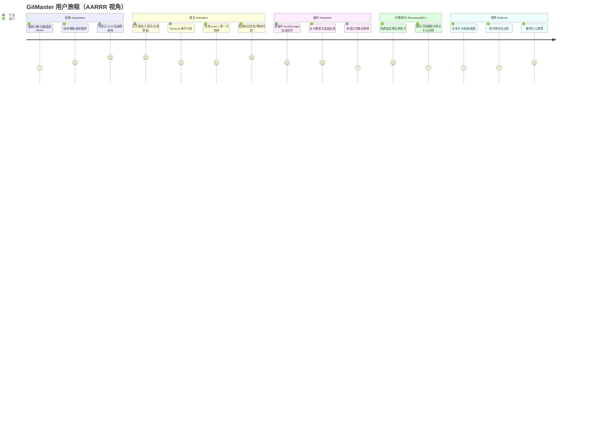
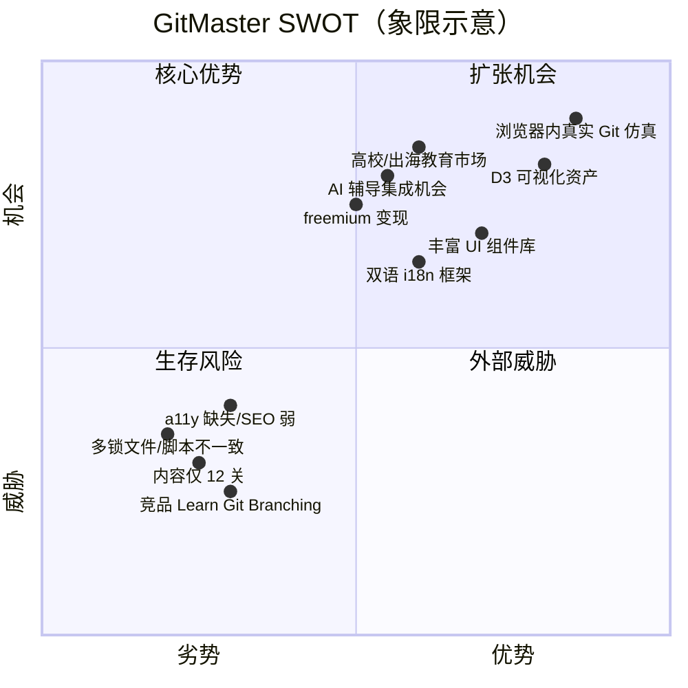

# GitMaster 产品战略分析（PM 研判）

> 文档角色：Builder（资深产品经理）｜跨文档阶段命名统一为 **M0–M6**
> 配套文档：`ROADMAP.md`（迭代路线图）
> 版本：v1.0（战略基线）｜口径日期：2026-07-07

---

## 1. 执行摘要（一页纸结论）

GitMaster 是一款**纯客户端 SPA**的沉浸式交互式 Git 学习平台，以"游戏化关卡 + 仿真终端 + D3 动态提交图谱"为核心差异化，定位"最直观真正掌握 Git 的方式"。当前技术栈现代、组件资产丰富（约 50 个 shadcn/Radix 组件），但**内容体量（实际 12 关）与产品叙事（号称 4 大章/约 50 关）存在显著落差**，且存在可量化的技术债。

| 维度 | 结论 | 优先级 |
|---|---|---|
| 定位 | 消费级 SaaS + 教育，免费先行、M5 起 freemium | 高 |
| 最大资产 | 浏览器内 Git 仿真 + D3 可视化，竞品难以低成本复制 | 高 |
| 最大风险 | 内容过薄（12 关）、多锁文件、a11y 缺失、SEO 弱（HashRouter） | 紧急 |
| 技术基线 | React 18 / Vite 5 / Tailwind 3.4 → 升级至 React 19 / Vite 7 / Tailwind v4 / TS 5.9（M0） | 高 |
| 工程化 | 已有 CI（Bun）/ GitHub Pages 部署，但锁文件与脚本口径不一致，需标准化为 pnpm（M0） | 中 |
| 商业化 | 暂不收费；M3 做账户云同步、M5 引入付费进阶订阅 | 规划中 |
| 北极星 | "周活跃完成关卡数"（Weekly Completed Levels, WCL） | 定义中 |

**一句话研判**：先把地基（M0）打牢、把内容闭环（M1）和体验/可达性（M2）做透，再谈上云（M3）与商业化（M5）；在内容厚度达到 ~50 关前，不宜大规模投放增长预算。

---

## 2. 产品概述与定位

### 2.1 产品形态

| 项 | 现状 |
|---|---|
| 形态 | 纯客户端 SPA，无后端；Git 模拟运行于浏览器（`src/store/gitStore.ts`，Zustand + Immer） |
| 学习载体 | 游戏化关卡（实际 12 关，分 4 主题分组：Genesis / Multiverse / Regret & Rewrite / The Ensemble） |
| 交互核心 | 仿真终端（输入真实 Git 命令）→ D3 动态提交图谱实时渲染 |
| 视觉/动效 | Framer Motion + Anime.js + Tailwind；暗黑模式；Driver.js 新手引导 |
| 多语言 | i18next + react-i18next，已接语言检测与切换；zh-CN / en JSON 已存在，但**部分 UI 仍硬编码** |
| 部署 | 阿里云 ESA 加速；生产域名 `gitmaster.qqyule.top`（亦见 `gitmaster.cc`）；GitHub Pages 部署流水线已存在 |
| 测试 | Vitest 4 + RTL，已存在单元/组件测试（如 `gitStore.test.ts`、`levels.test.ts`） |

### 2.2 核心价值主张（Value Proposition）

> **"在最像真实 Git 的环境里，把抽象概念变成看得见的图谱。"**

- **真实感**：不是选择题，而是真正敲 `git commit` / `git rebase`，错误与真实 Git 行为一致。
- **可视化直觉**：提交、分支、合并以 D3 动态图谱呈现，"所见即所得"。
- **零安装**：纯浏览器运行，打开即学，无需本地装 Git。
- **双语沉浸**：中英文无缝切换，面向全球开发者（含中国高校/出海团队）。

### 2.3 定位矩阵

|  | 重理论/文档 | 重实操/交互 |
|---|---|---|
| **单机/轻量** | Pro Git 电子书 | **GitMaster（本项目）** |
| **重型/桌面** | GitKraken Learn | GitKraken 客户端 |

GitMaster 占据"**轻量 + 强交互可视化**"的空白象限，是入门到进阶之间性价比最高的练习场。

---

## 3. 用户画像（Persona）

### Persona A — "转行新手" Leo（学生 / 转码者）
- **场景**：计算机专业大二 / 从运营转开发，第一次接触版本控制，被 `rebase` 劝退。
- **痛点**：命令行恐惧；看书看不懂；公司要求用 Git 但没人带。
- **诉求**：低门槛、即时反馈、能"看见"分支怎么长出来。
- **与产品契合**：仿真终端 + D3 图谱 + 游戏化进度，零安装即可起步。

### Persona B — "进阶焦虑" Mia（1–3 年工程师）
- **场景**：会用 `add/commit/push`，但遇到 `rebase`、冲突、回滚就慌；准备面试。
- **痛点**：缺乏"为什么这样"的因果理解；现有教程碎片化。
- **诉求**：系统性进阶路径、可重复练习、错误可视化复盘。
- **与产品契合**：Regret & Rewrite、Multiverse 等进阶关卡 + 进度持久化（M1）。

### Persona C — "布道者" Prof. Chen（高校教师 / 技术讲师）
- **场景**：带实验课，希望学生课前自练 Git。
- **痛点**：统一教学环境难、无法追踪学生完成情况。
- **诉求**：可分享的关卡、班级/排行榜、教学数据。
- **与产品契合**：M4 的 UGC 关卡编辑器 + 排行榜，M6 的 B2B 教育版。

---

## 4. 用户旅程地图（获客 → 激活 → 留存 → 推荐）

**关键摩擦点**（需在路线图中消除）：
1. 首屏 SEO 弱（HashRouter）→ 获客转化衰减。
2. 进度仅存本地 → 换设备即丢失，留存受损（M3 解决）。
3. a11y 缺失 → 部分用户（键盘/读屏）被挡在激活门外（M2 解决）。

---

## 5. 竞品分析

| 维度 | **GitMaster（本项目）** | Learn Git Branching | GitKraken Learn | Atlassian Git Tutorials | Pro Git / Visualizing Git |
|---|---|---|---|---|---|
| 核心交互 | 仿真终端 + D3 实时图谱 | 可视化沙盒（关卡式） | 文档+视频+桌面客户端 | 图文教程 | 文档/静态图 |
| 真实 Git 命令 | ✅ 浏览器内模拟 | ⚠️ 简化沙盒 | ✅（接真实仓库） | ❌ | ❌ |
| 游戏化 | ✅ 关卡+进度 | ✅ 关卡 | ⚠️ 弱 | ❌ | ❌ |
| 动态图谱 | ✅ D3 实时 | ✅ 动画图 | ✅ 客户端图 | ❌ | ⚠️ 静态 |
| 国际化 | ⚠️ zh/en 框架在，部分硬编码 | ⚠️ 多语言但不全 | ✅ 英文为主 | ✅ 多语言 | ✅ 多语言译本 |
| 多端/云同步 | ❌（仅 localStorage，M3 规划） | ❌ | ✅（账户体系） | ❌ | ❌ |
| 商业化 | 免费；M5 freemium 规划 | 免费+捐赠 | 付费订阅（桌面） | 免费（导流产品） | 免费（O'Reilly 书） |
| 开源/可扩展 | ✅ 公开仓库；M4 UGC 规划 | ❌ | ❌ | ❌ | ✅ 开源书 |
| 差异化 | **真实命令×实时图谱×零安装×双语** | 教学动画成熟 | 工程化重 | 官方权威 | 内容权威 |

**研判**：GitMaster 在"真实命令 + 实时可视化 + 零安装"组合上具备差异化护城河；短期短板是**内容厚度（12 vs 竞品数十关）**与**账户/云能力**。竞品中 Learn Git Branching 是最直接对手，但其为简化沙盒、非真实 Git；GitMaster 应坚持"真实感"差异，避免陷入"动画更花哨"的红海。

---

## 6. SWOT 分析（结合架构与技术债）

### 6.1 优势（Strengths）
- 浏览器内 Zustand Git 仿真引擎，体验真实且零安装。
- D3 动态提交图谱是强视觉资产，复刻成本高。
- 约 50 个 shadcn/Radix 组件资产，UI 一致性与开发速度快。
- 已建立 i18n 框架、CI、测试与部署流水线。

### 6.2 劣势（Weaknesses）
- **内容过薄**：实际仅 12 关，远低于"4 大章/约 50 关"叙事，留存与转化天花板低。
- **技术债**：(1) 同时存在 `bun.lockb` + `pnpm-lock.yaml` + `package-lock.json`，且 CI 用 Bun、README 用 pnpm，口径混乱；(2) `biome.json` 关闭了 `noSvgWithoutTitle` / `noStaticElementInteractions` 等 a11y 规则；(3) 采用 HashRouter，SEO 弱；(4) 曾删除过的 AI 审查 CI（cr.yml）反映工程治理波动。
- 纯客户端架构：无账户、无云同步，跨设备与商业化能力受限。

### 6.3 机会（Opportunities）
- 高校/培训市场、中国开发者出海双语需求。
- M4 UGC 关卡编辑器可形成内容飞轮与社区。
- AI 辅导（解释错误、生成练习）可低成本叠加。
- M5 freemium 与教育 B2B（M6）变现路径清晰。

### 6.4 威胁（Threats）
- Learn Git Branching 等成熟竞品先发认知。
- 纯前端项目易被"克隆式"复刻，护城河在内容+社区而非代码。
- 阿里云 ESA 等外部依赖变更风险（部署/加速）。

---

## 7. 商业模式与免费策略

### 7.1 总原则
- **当前：完全免费，无付费墙**，以增长与口碑为先。
- **M3**：引入轻量账户 + 云进度同步，仍为免费能力（freemium 地基）。
- **M5**：正式 freemium——免费层覆盖日常练习，付费"进阶订阅"解锁大师关卡、AI 辅导、云同步高级额度、去广告/优先支持。

### 7.2 免费层 / 付费层划分（M5 起）

| 能力 | 免费层 | 付费进阶（M5+） |
|---|---|---|
| 基础关卡（Genesis/Multiverse 等） | ✅ | ✅ |
| 进度本地保存 | ✅ | ✅ |
| 云跨设备同步 | ❌（M3 起限免） | ✅ 无限 |
| 大师/专题关卡包 | ❌（部分） | ✅ |
| AI 错误解释 / 个性化练习 | ❌ | ✅ |
| 教师/班级看板（M6 B2B） | ❌ | ✅ 订阅/席位 |

### 7.3 变现补充（M5–M6）
- 联盟：开发工具/课程 affiliate。
- 邮件：学习进度提醒 + 进阶内容培育。
- B2B 教育版（M6）：学校/企业席位与开放 API/SDK。

---

## 8. 关键指标（North Star + 漏斗 + 技术健康度）

### 8.1 北极星指标
**周活跃完成关卡数（Weekly Completed Levels, WCL）** —— 同时衡量"规模（活跃用户）"与"价值交付（学会 Git）"，优于单纯 DAU/PV。

### 8.2 激活 / 留存 / 完成漏斗

| 漏斗阶段 | 定义 | 目标（M2 后基线，M5 优化） |
|---|---|---|
| 访问 → 启动关卡 | 首页进入任一关卡 | ≥ 60% |
| 激活（首关完成） | 完成 level-1 | ≥ 40% |
| 进阶（完成 ≥3 关） | 跨过新手阈值 | ≥ 25% |
| 7 日留存 | 7 天内回访 | ≥ 20%（M3 云同步后↑） |
| 章节完成率 | 单章节全通关 | ≥ 15% |
| 推荐率 | 分享/邀请行为 | 监控 + 实验 |

### 8.3 技术健康度指标（与 M0–M2 对齐）

| 指标 | 现状 | 目标 |
|---|---|---|
| 锁文件 | 3 份并存 | M0：统一 pnpm 单锁 |
| 包管理器 CI/脚本口径 | Bun vs pnpm 不一致 | M0：全链路 pnpm |
| a11y 规则覆盖率 | 部分关闭 | M2：100% 开启并通过 |
| i18n 覆盖率 | 部分硬编码 | M2：100% 外部化 |
| 构建产物/首屏 | HashRouter | M2：SEO 友好路由 |
| 测试通过率 | 已有 Vitest | M1：关卡校验/防作弊单测覆盖 |

---

## 9. 质量与技术风险矩阵（概率 × 影响）

| # | 风险 | 概率 | 影响 | 等级 | 缓解措施 | 归属阶段 |
|---|---|---|---|---|---|---|
| R1 | 内容过薄导致留存/口碑不达标 | 高 | 高 | **红** | 内容扩产路线（M1 校验机制 + M4 UGC 反哺） | M1/M4 |
| R2 | 多锁文件致 CI 不一致/幽灵依赖 | 中 | 高 | **红** | M0 统一 pnpm，删除 bun/package-lock | M0 |
| R3 | a11y 缺失致合规/可及性诉讼与流失 | 中 | 中 | **橙** | M2 开启全部 Biome a11y 规则并修复 | M2 |
| R4 | HashRouter SEO 弱，获客成本高 | 高 | 中 | **橙** | M2 切换至 SEO 友好路由（如 BrowserRouter + SSG/预渲染） | M2 |
| R5 | 纯客户端无防作弊，进度/成就失真 | 中 | 中 | **橙** | M1 关卡校验 + 服务端校验地基（M3） | M1/M3 |
| R6 | 升级 React19/Vite7/Tailwind v4 引入破坏性变更 | 中 | 高 | **红** | M0 灰度升级 + 测试门禁 + 组件回归 | M0 |
| R7 | 早期重商业化损害口碑 | 低 | 高 | **橙** | 坚持 M5 前不收费；免费层长期保留 | M5 |
| R8 | 云后端选型/成本失控（M3） | 中 | 中 | **橙** | 优先 Cloudflare D1 / Supabase 免费层 | M3 |
| R9 | 外部依赖（阿里云 ESA）变更/中断 | 低 | 中 | **黄** | 多托管兜底（Pages/ESA/Pages CDN） | M0/M2 |
| R10 | 竞品先发认知压制 | 中 | 中 | **橙** | 强化"真实命令×实时图谱"差异叙事 | 持续 |

> 风险等级：红=立即处理，橙=阶段内必须解决，黄=监控。

---

## 10. 与路线图（ROADMAP.md）的衔接

- 本文为**战略研判**，给出"做什么/为什么"；`ROADMAP.md` 给出"何时做/怎么做/验收"。
- 全阶段命名强制统一 **M0（地基与 CI/CD）→ M6（规模化与平台化）**。
- 本回合**仅产出战略文档**，不改动任何 `src/*` 或 `package.json`（详见 ROADMAP 末尾"已规划未执行"边界）。
