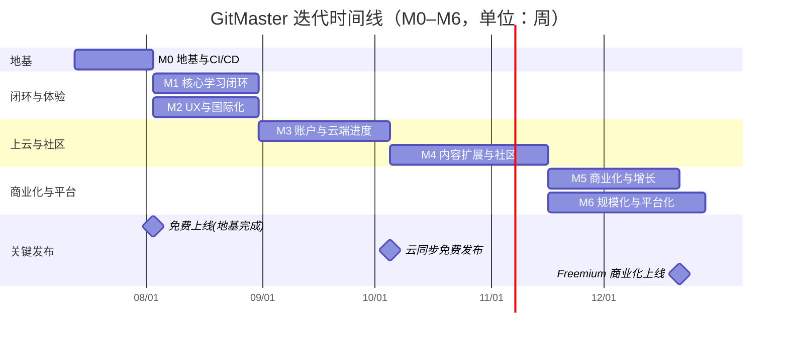

# GitMaster 迭代路线图（M0–M6）

> 文档角色：Builder（资深产品经理）｜阶段命名与 `PM-ANALYSIS.md` 严格一致：**M0–M6**
> 配套文档：`PM-ANALYSIS.md`（产品战略分析）
> 版本：v1.0（战略基线）｜口径日期：2026-07-07
> 边界声明：本文件为**战略与计划文档**，本回合**不修改任何 `src/*` 或 `package.json`**。

---

## 0. 阶段总览

| 阶段 | 名称 | 一句话目标 | 预估周期 | 关键依赖 |
|---|---|---|---|---|
| M0 | 地基与 CI/CD | 统一技术基线（React 19 / Vite 7 / Tailwind v4 / TS 5.9）+ 全链路 CI/CD + 锁文件标准化 | 3 周 | 无（起点） |
| M1 | 核心学习闭环打磨 | 终端引擎健壮性、关卡校验/防作弊、进度持久化 | 4 周 | M0 |
| M2 | UX 与国际化加固 | a11y 100%、动效一致性、i18n 100%、SEO | 4 周 | M0 |
| M3 | 账户与云端进度 | 轻量后端（D1/Supabase 免费层）、跨设备同步、freemium 地基 | 5 周 | M1/M2 |
| M4 | 内容扩展与社区 | UGC 关卡编辑器、分享、排行榜 | 6 周 | M3 |
| M5 | 商业化与增长 | 免费层 + 付费进阶订阅、联盟、邮件 | 5 周 | M3/M4 |
| M6 | 规模化与平台化 | 开放 API / SDK、B2B 教育版 | 6 周+ | M4/M5 |

> 周期单位为"人周（基准团队 2–3 人）"，为计划估算，非承诺工期。

---

## M0 — 地基与 CI/CD（3 周）

### 目标
将技术基线升级到最新稳定栈，统一包管理与锁文件，建立可重复、可发布的 CI/CD 全链路，为后续所有迭代提供稳定底座。（CI/CD 细节由工程侧 Builder 负责落地，本阶段只定义目标与验收。）

### 范围 / 功能清单
- 技术基线升级：React 18 → **19**、Vite 5 → **7**、Tailwind CSS 3.4 → **v4**、TypeScript 5.8 → **5.9**。
- 锁文件标准化：仅保留 **pnpm** 单一锁文件，删除 `bun.lockb` 与 `package-lock.json`。
- 脚本口径统一：CI 与 README/脚本一致使用 pnpm（`pnpm install --frozen-lockfile`）。
- 重建并验证 CI（Lint·Typecheck·Test·Build）与部署流水线，确保 main 合入即产出可部署产物。

### 技术任务
- 升级依赖并处理 React 19 / Vite 7 / Tailwind v4 破坏性变更（如 `@types`、PostCSS 插件、配置文件迁移）。
- 全量运行 Vitest + RTL 回归，修复升级引入的测试/类型失败。
- 锁文件清理策略：删除多余锁文件 → 重新 `pnpm install` → 提交 `pnpm-lock.yaml`。
- 与工程 Builder 对齐 CI/CD 门禁（Biome ci、tsc -b、vitest、build artifact）。

### 可量化验收标准
- [ ] 仓库仅存在 **1 个**锁文件（`pnpm-lock.yaml`），CI 与本地均用 pnpm。
- [ ] `pnpm lint` / `pnpm typecheck` / `pnpm test` / `pnpm build` 全绿。
- [ ] React 19 / Vite 7 / Tailwind v4 / TS 5.9 在 `package.json` 生效且 `dist` 正常产出。
- [ ] 每次 main 合入触发 CI 全链路，并产出可部署 `dist` 产物。

### 依赖
- 无（起点阶段）。需与"技术重构 Builder""CI/CD Builder"协同。

---

## M1 — 核心学习闭环打磨（4 周）

### 目标
把"学→练→校验→留存"主闭环做扎实：终端引擎更稳、关卡结果可校验且抗作弊、进度可靠持久化。

### 范围 / 功能清单
- 终端引擎健壮性：命令解析边界、错误提示、异常输入不崩溃。
- 关卡校验器：基于 `gitStore` 状态断言"目标是否达成"，取代纯前端旁路判定。
- 防作弊：检测直接篡改 store / localStorage 伪造进度；M3 起可接服务端二次校验。
- 进度持久化：统一 `progressStore` 读写，断点续学、关卡解锁状态稳定。
- 内容扩产铺垫：定义关卡数据结构标准，为 M4 UGC 打底。

### 技术任务
- 在 `gitStore.ts` 增加可序列化的"达成条件"评估接口；补充 `gitStore.test.ts` / 关卡单测。
- 对 `progressStore.ts` 增加校验与版本迁移（schema versioning）。
- 编写命令边界用例（空输入、未知命令、破坏性命令在模拟环境的隔离）。

### 可量化验收标准
- [ ] 关卡完成判定 100% 由状态断言驱动，单测覆盖核心关卡 ≥ 80%。
- [ ] 篡改 localStorage 进度可被检测并标记（至少告警/重置）。
- [ ] 进度在刷新/重开后 100% 恢复，解锁链无错乱。
- [ ] 终端在 20 类异常输入下不白屏/不崩溃。

### 依赖
- M0（稳定基线，避免升级干扰测试）。

---

## M2 — UX 与国际化加固（4 周）

### 目标
让产品可达、一致、可被搜索引擎发现，并把双语做到真正 100% 覆盖。

### 范围 / 功能清单
- **a11y 100%**：开启 `biome.json` 中全部 a11y 规则（`noSvgWithoutTitle`、`noStaticElementInteractions` 等）并修复。
- 动效一致性：统一 Framer Motion / Anime.js 使用规范，建立动效 token。
- **i18n 100%**：抽离所有硬编码 UI 字符串至 `zh-CN.json` / `en.json`，建立缺失 key 的 CI 校验。
- **SEO**：由 HashRouter 迁移至 SEO 友好路由（BrowserRouter / 预渲染），补充 meta/OG/结构化数据。

### 技术任务
- 逐项修复 Biome a11y 告警（SVG 标题、可交互元素语义、焦点管理等）。
- 扫描 `src/**` 硬编码中文/英文文案 → 外部化；增加 i18n key 完整性检查脚本。
- 路由与静态托管配置调整（需与 M0 部署协同，确保 ESA/Pages 兼容）。

### 可量化验收标准
- [ ] `biome ci` 中 a11y 规则 0 关闭、0 告警。
- [ ] i18n 覆盖率 100%（CI 校验无遗漏 key，无硬编码文案）。
- [ ] 中文/英文切换下所有页面无残存外语或空串。
- [ ] 关键页面可被搜索引擎收录（sitemap + meta + 合理路由）。

### 依赖
- M0（路由/构建改造基础）。

---

## M3 — 账户与云端进度（5 周）

### 目标
引入轻量账户与云同步，打通跨设备体验，并为 freemium 铺设身份与配额地基。

### 范围 / 功能清单
- 轻量后端：Cloudflare D1 或 Supabase 免费层（选型在 M0/M3 初定）。
- 账户体系：邮箱/第三方登录（最小实现），免费层即可用。
- 跨设备同步：进度云备份 + 多端恢复；本地优先、冲突合并策略。
- freemium 地基：用户/订阅数据模型、配额与特性开关（feature flag）。

### 技术任务
- 抽象"进度存储"接口：本地 `progressStore` 与远端同步适配。
- 服务端校验接入口（承接 M1 防作弊的二次校验）。
- 数据模型与迁移脚本；隐私与合规最小集（仅必要数据）。

### 可量化验收标准
- [ ] 注册/登录成功率 ≥ 95%，免费层无需付费。
- [ ] 换设备后进度恢复率 ≥ 99%，冲突有清晰合并提示。
- [ ] 服务端对关键关卡达成可二次校验（防作弊闭环）。
- [ ] 特性开关可区分免费/付费能力（为 M5 准备）。

### 依赖
- M1（校验/防作弊）、M2（a11y/SEO 不阻塞但建议前置）。

---

## M4 — 内容扩展与社区（6 周）

### 目标
用 UGC 与社区机制解决"内容过薄"这一最大风险，形成内容飞轮。

### 范围 / 功能清单
- UGC 关卡编辑器：基于 M1 定义的关卡数据结构，可视化/JSON 双模式编辑。
- 关卡分享：链接/图谱快照分享，社媒卡片（依赖 M2 SEO/OG）。
- 排行榜：完成度/速度榜，驱动留存与推荐。
- 官方内容扩产：向 ~50 关目标推进（4 大章叙事落地）。

### 技术任务
- 关卡 Schema 公开与校验 SDK（ feeders 复用 M1 校验器）。
- 分享链路与防滥用（结合 M3 账户）。
- 排行榜数据管线（服务端聚合）。

### 可量化验收标准
- [ ] UGC 关卡可发布并被他人游玩，端到端可用。
- [ ] 官方关卡数达到 ≥ 40（向 ~50 收敛），章节结构完整。
- [ ] 分享卡片在主流平台可正确预览。
- [ ] 排行榜日活参与率 ≥ 10%。

### 依赖
- M3（账户/后端）、M1（校验器复用）。

---

## M5 — 商业化与增长（5 周）

### 目标
在免费层之上引入 freemium 付费进阶，启动增长与变现，坚持"M5 前不收费"。

### 范围 / 功能清单
- 付费进阶订阅：大师关卡包、AI 辅导、无限云同步、去广告/优先支持。
- 免费层长期保留（日常练习全免费），避免口碑反噬（见 PM 风险 R7）。
- 联盟（affiliate）与邮件培育（进度提醒 + 进阶内容）。
- 增长实验：落地页、激活漏斗优化（对齐 PM 第 8 章指标）。

### 技术任务
- 订阅/支付集成（最小可行：Stripe/国内等价方案之一）。
- 特性开关与配额接入 M3 数据模型。
- 邮件与联盟追踪埋点。

### 可量化验收标准
- [ ] 免费层功能不降级；付费层独立可购买、可退订。
- [ ] 订阅转化（激活→付费）≥ 2%（起步基线，持续实验）。
- [ ] 邮件触达合规（订阅/退订）且打开率可监控。
- [ ] 北极星指标 WCL 在 M5 期间保持正增长。

### 依赖
- M3（账户/订阅地基）、M4（内容厚度支撑付费价值）。

---

## M6 — 规模化与平台化（6 周+）

### 目标
从"产品"走向"平台"：开放能力、切入 B2B 教育市场。

### 范围 / 功能清单
- 开放 API / SDK：关卡、进度、成绩查询与嵌入。
- B2B 教育版：班级/席位、教师看板、作业与完成度追踪。
- 多租户与配额治理、企业级合规基线。

### 技术任务
- 公开 API 网关与鉴权、SDK 与文档站。
- 教育版数据模型（班级/课程/成绩）与教师后台。
- 平台稳定性与 SLA 基线（监控、限流）。

### 可量化验收标准
- [ ] 开放 API 文档完整、可用示例，SDK 可嵌入第三方页。
- [ ] 教育版支持班级创建、学生进度看板可用。
- [ ] 平台可用性 ≥ 99.5%（核心学习链路）。

### 依赖
- M4（内容/社区）、M5（订阅/席位计费延伸）。

---

## 时间线 / Gantt（Mermaid gantt）

> 说明：M2 与 M1 可在 M0 后并行以压缩总周期；M5/M6 共享 M4 依赖后可部分并行。

---

## 里程碑与发布节奏

| 里程碑 | 触发阶段 | 发布含义 | 商业化状态 |
|---|---|---|---|
| **免费上线（地基完成）** | M0 结束 | 以最新稳定栈 + 标准 CI/CD 重新发布，SEO/体验随 M2 持续增强 | 完全免费 |
| **学习闭环 GA** | M1+M2 结束 | 校验/持久化/a11y/i18n/SEO 达标，质量基线确立 | 完全免费 |
| **云同步免费发布** | M3 结束 | 账户 + 跨设备同步（免费能力），freemium 地基就绪 | 免费 + 地基 |
| **内容/社区里程碑** | M4 结束 | UGC + 排行榜，官方关卡向 ~50 收敛 | 免费为主 |
| **Freemium 商业化上线** | M5 结束 | 付费进阶订阅开放，**首次变现**，免费层不降级 | 免费 + 付费 |
| **平台化/B2B** | M6 结束 | 开放 API/SDK + 教育版 | 免费 + 付费 + B2B |

发布节奏建议：**每阶段结束即一次可发布版本**；M0–M4 聚焦"先把产品做对"，M5 起才引入付费，保护早期口碑（对齐 PM 风险 R7）。

---

## 本回合"已规划但未执行"边界（重要）

> 本回合为**战略文档交付**，严格遵守"不修改任何现有源代码（`src/*`）或 `package.json`"的约束。

| 项 | 状态 | 说明 |
|---|---|---|
| `docs/PM-ANALYSIS.md` | ✅ 已产出 | 本回合交付物 |
| `docs/ROADMAP.md` | ✅ 已产出 | 本回合交付物 |
| 升级 React 19 / Vite 7 / Tailwind v4 / TS 5.9 | ⏳ 规划未执行 | 属 M0 工程改造，待工程 Builder 执行 |
| 删除 `bun.lockb` / `package-lock.json`、统一 pnpm | ⏳ 规划未执行 | 属 M0，不在本文落地 |
| a11y 规则开启与修复 | ⏳ 规划未执行 | 属 M2，不动 `biome.json` |
| i18n 硬编码抽离 | ⏳ 规划未执行 | 属 M2，不动 `src/*` |
| HashRouter → SEO 路由迁移 | ⏳ 规划未执行 | 属 M2 |
| 关卡校验/防作弊/云同步 | ⏳ 规划未执行 | 属 M1/M3 |
| CI/CD 流水线重写细节 | ⏳ 规划未执行 | 由 CI/CD Builder 负责，本文仅定义目标 |

**一句话边界**：本文档为"决策与计划"，不是"代码改造"；所有 `src/*`、`package.json`、`biome.json`、CI 工作流文件在本回合均保持不变，待对应 Builder 在 M0–M6 中按本计划执行。
