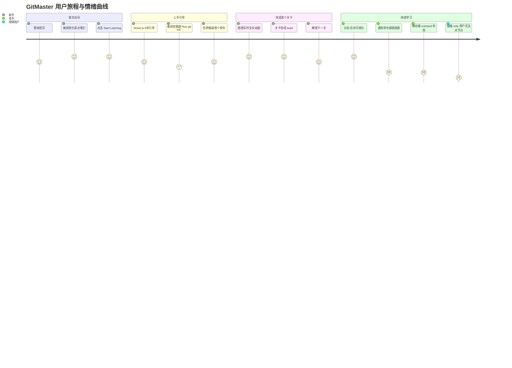
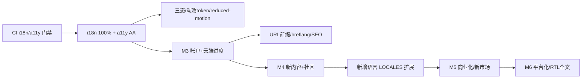

# GitMaster · UX 与国际化（i18n）战略文档

> **角色**：Builder — UX / 国际化设计师
> **范围**：纯客户端 SPA，无后端；本回合仅产出战略文档，不修改任何 `src/*` 或配置文件。
> **阶段命名（统一，跨文档一致）**：
> M0 地基与 CI/CD · M1 核心学习闭环打磨 · M2 UX 与国际化加固（a11y 100% / i18n 100% / SEO）· M3 账户与云端进度 · M4 内容扩展与社区 · M5 商业化与增长 · M6 规模化与平台化

---

## 0. 文档地图

| 模块 | 核心问题 | 主导阶段 |
| --- | --- | --- |
| A. UX 策略 | 交互体验如何达到"无障碍 100% + 动效一致 + 三态闭环" | **M2**（跨 M1/M3） |
| B. i18n 策略 | 如何把覆盖率从"含硬编码"提升到 100%，并支撑新市场 | **M2 → M3+** |

目标基线（M2 验收硬指标）：
- 所有交互组件 **WCAG 2.2 AA** 通过（键盘可达、焦点管理、ARIA、对比度、Screen Reader）。
- i18n 覆盖率 **100%**（无硬编码用户可见字符串，CI 拦截缺失键）。
- `prefers-reduced-motion` 全局尊重。
- 移动端断点响应式 + 触控可达。

---

# A. UX 策略

## A.1 当前交互盘点

| 交互模块 | 现状 | 体验评估 | 主要问题 |
| --- | --- | --- | --- |
| 仿真终端 `Terminal.tsx` | 受控 input + 历史回放 + 上/下键调历史；Framer Motion 高度展开 | ⚠️ 可用但偏"玩具" | 头部"Terminal"、欢迎语、placeholder 均**硬编码未 i18n**；输出区 `role="button"` 但实际只聚焦输入框，语义不清；无命令自动补全/语法提示 |
| 关卡流程 `LearnPage/LevelSidebar` | 左侧关卡导航（完成✓/锁定），右侧目标+提示 | ✅ 主线清晰 | 锁定关卡无"差多少"进度暗示；关卡间仅靠 toast 通知完成 |
| D3 提交图谱 `GitGraphSvg.tsx` | SVG 节点 + 分支标签 + HEAD 指示器，Framer Motion 路径动画 | ✅ 视觉强 | **SVG 无 `role`/`aria-label`**；节点 `onClick` 但**无键盘可达**（无法 Tab/Enter 触发 `onNodeClick`）；空态"Run git init to start"硬编码；`<title>` 仅 hover 可见 |
| Driver.js 引导 `tourSteps.ts` | 6 步高亮（sidebar/level/graph/terminal/files） | ✅ 结构良好 | 未尊重 reduced-motion；弹窗定位在窄屏可能溢出；完成状态存 localStorage，无"稍后不再提示"细粒度控制 |
| 暗色模式 `theme-provider/theme-toggle` | next-themes + class 切换 | ✅ 稳定 | 切换时图谱 glow 滤镜/对比度未校准；无"跟随系统"显式提示 |
| 动效 `animations.ts` + Framer | animejs（进场/出场/脉冲/交错）+ Framer（页面/图谱） | ⚠️ 双引擎并存 | **全局无 `prefers-reduced-motion` 判断**；两套时长/缓动不统一（anime 默认 800ms easeOutExpo，Framer 0.2–1s 不等），无动效 token |
| Toast 反馈 `sonner` | 关卡完成/操作结果提示 | ✅ 即时有反馈 | 无分级（成功/警告/错误同色系）；错误态未与表单/终端失败强关联；未提供"重播/撤销"动作 |

**关键洞察**：视觉表现力强，但**无障碍与一致性是系统性短板**——biome.json 中 7 条 a11y 规则被关闭（`noSvgWithoutTitle`、`noLabelWithoutControl`、`useSemanticElements`、`noStaticElementInteractions`、`useKeyWithClickEvents`、`useFocusableInteractive`、`useAriaPropsForRole` 均为 off），说明静态可检测的 a11y 问题未纳入门禁。

## A.2 体验地图（Experience Map）与痛点清单

### 体验地图（Mermaid 纵向旅程）



### 痛点清单（按阶段归因）

| # | 痛点 | 受影响用户 | 严重度 | 归属阶段 |
| --- | --- | --- | --- | --- |
| P1 | SVG 图谱节点无法键盘操作，屏幕阅读器不可读 | 障碍用户/键盘用户 | 🔴 高 | M2 |
| P2 | 动效未尊重 reduced-motion，眩晕/前庭敏感用户不适 | 前庭敏感用户 | 🔴 高 | M2 |
| P3 | 终端/图谱/404 等硬编码英文，非英语用户割裂 | 非英语用户 | 🟠 中 | M2(B) |
| P4 | 命令报错仅有 toast，缺"为什么/怎么修"引导 | 新手 | 🟠 中 | M1/M2 |
| P5 | 移动端布局未验证，触控目标过小 | 移动用户 | 🟠 中 | M2 |
| P6 | 三态缺失：加载/空/错误无统一设计，loading 仅纯文本 | 全体 | 🟡 低 | M2 |
| P7 | 动效双引擎、无 token，时长/缓动不一致 | 全体（一致性） | 🟡 低 | M2 |
| P8 | 暗色下图谱对比度未校准 | 低视力用户 | 🟡 低 | M2 |

## A.3 Nielsen 十大启发式评估

评分：⭐1–5（5 最优）。缺口 = 当前未满足点。改进 = M2 行动。

| # | 启发式 | 评分 | 缺口 | 改进建议（阶段） |
| --- | --- | --- | --- | --- |
| 1 | 系统状态可见性 | ⭐⭐⭐⭐ | 命令执行无"运行中"态；错误无专属样式 | 统一三态 + 命令执行 loading（M2） |
| 2 | 现实世界匹配 | ⭐⭐⭐⭐ | 仿真命令与真实 git 语义一致，但报错文案偏技术 | 错误文案本地化 + 通俗化（M2/M1） |
| 3 | 用户控制与自由 | ⭐⭐⭐ | 关卡不可"重玩/跳过引导"细粒度；reset 无二次确认 | 引导可跳过/重放；危险操作确认（M1/M2） |
| 4 | 一致性与标准 | ⭐⭐⭐ | 动效双引擎、时长不统一；按钮样式散落 | 动效 token + 组件级一致性（M2） |
| 5 | 错误预防 | ⭐⭐⭐ | 无效命令无预校验/提示 | 命令语法提示 + 输入校验（M1） |
| 6 | 识别而非回忆 | ⭐⭐⭐⭐ | 关卡目标常驻侧栏，较好 | 维持；补充快捷命令速查（M1） |
| 7 | 灵活高效 | ⭐⭐ | 无键盘快捷键、无命令历史持久化、节点不可键盘选 | 快捷键 + 键盘可达图谱（M2/M3） |
| 8 | 美学与极简 | ⭐⭐⭐⭐ | 视觉优秀，但引导弹窗信息密度偏高 | 引导文案精简（M2） |
| 9 | 容错与帮助 | ⭐⭐ | 报错无"帮助链接/重试"；无 in-context 帮助 | 错误 toast 带"查看提示"动作（M1/M2） |
| 10 | 文档与帮助 | ⭐⭐⭐ | 关卡 hints 够用，但无全局搜索/FAQ | 帮助中心（M4） |

**汇总**：可达 WCAG AA 的核心短板集中在 #7（灵活高效/键盘可达）、#3（控制自由）、#1（状态可见性）；无障碍是 M2 的"杠杆点"。

## A.4 改进项（主 M2，跨阶段）

### A.4.1 无障碍 a11y → WCAG 2.2 AA
- [ ] **键盘可达**：`GitGraphSvg` 节点改为 `<button>` 或加 `tabIndex/role="button"/onKeyDown(Enter/Space)`，使 `onNodeClick` 可键盘触发（P1）。
- [ ] **焦点管理**：模态/引导/Drawer 打开时焦点陷阱（Radix 已内置，确保 `Dialog/Sheet` 用于浮层）；引导结束后焦点回到触发点。
- [ ] **ARIA**：SVG 容器加 `role="img"` + `aria-label`；动态图谱对 Screen Reader 提供文本摘要（如"3 commits, 2 branches"）；终端输出区语义改为 `role="log"` + `aria-live="polite"`。
- [ ] **色彩对比**：用 `npm run lint`（重开 biome a11y 规则）后，对暗色下图谱标签/分支文字做对比度校验（≥4.5:1 正文 / 3:1 大字）。
- [ ] **Screen Reader 文本**：所有图标按钮补 `aria-label`/`sr-only`（语言切换已做，需全量审计）。
- [ ] **门禁**：在 M0 CI 中开启 biome a11y 全部规则为 `error`（当前多为 off），新代码 0 警告合入。

### A.4.2 `prefers-reduced-motion` 支持
- [ ] 在 `index.css` / `animations.ts` 增加全局守卫：`const prefersReduced = matchMedia('(prefers-reduced-motion: reduce)').matches`，命中时 animejs 直接 `opacity` 终态、跳过位移（P2）。
- [ ] Framer Motion 统一用 `useReducedMotion()` hook，reduced 时 `transition={{ duration: 0 }}`。
- [ ] Driver.js 在 reduced 模式下关闭高亮过渡动画。

### A.4.3 加载 / 空 / 错误 三态设计
| 状态 | 设计要点 | 落地 |
| --- | --- | --- |
| 加载 | Skeleton（关卡列表/图谱）替代纯文本 "Loading..." | `common.loading` 配合 `Skeleton` 组件 |
| 空 | 友好插画 + 下一步 CTA（如空图谱"Run git init"→按钮） | `GitGraphSvg` 空态改造 |
| 错误 | 分级（destructive/information），带"重试/查看提示"动作 | Sonner `toast.error` + action |

### A.4.4 移动端响应式与触控
- [ ] 断点验证：`use-mobile` 已存在，补真机/DevTools 设备矩阵测试清单（320/375/768/1024）。
- [ ] 触控目标 ≥ 44×44px（终端展开折叠按钮、关卡项、图谱节点命中区）。
- [ ] 布局：窄屏将"侧栏+图谱+终端"改为可滚动 Tab/抽屉（复用 `Sheet`/`Tabs`），避免横向溢出。

### A.4.5 微交互与动效一致性（动效 token）
- [ ] 收敛双引擎：**页面/组件级用 Framer，命令式 DOM 动画用 animejs**，但共用同一组 token。
- [ ] 在 `tailwind.config` / 迁移后的 `@theme`（见 A.5）定义动效 token：

  | Token | 值 | 用途 |
  | --- | --- | --- |
  | `--duration-fast` | 150ms | 微交互（hover/tap） |
  | `--duration-base` | 250ms | 展开/收起 |
  | `--duration-slow` | 400ms | 页面/图谱进场 |
  | `--ease-standard` | cubic-bezier(.4,0,.2,1) | 默认缓动 |
  | `--ease-spring` | spring(stiffness 500, damping 30) | 节点弹动 |

- [ ] 所有动画时长/缓动引用 token，移除 `animations.ts` 中散落的魔法数字。

### A.4.6 表单与反馈闭环
- [ ] 终端输入增加**命令校验/补全提示**（Zod 校验输入格式，错误内联提示）。
- [ ] 错误 toast 提供"查看关卡提示""重试"动作，形成闭环（P4/P9）。
- [ ] 关卡完成 → 明确的"下一关"入口 + 进度回写（M3 云端进度前置埋点）。

### A.4.7 埋点与满意度收集（NPS/CSAT）
- [ ] 事件埋点（M3 前先用本地 analytics 抽象，避免耦合后端）：`level_start/complete`、`command_run(success/fail)`、`tour_skip`、`lang_switch`、`theme_toggle`。
- [ ] 关卡完成后弹轻量 **CSAT**（👍/👎 + 可选原因）；每 N 关或退出时 **NPS**。
- [ ] 数据进入 M3 用户画像，驱动 M4 内容扩展。

## A.5 设计系统 / 动效 token 建议（呼应 Tailwind v4 `@theme` 迁移）

> 与"最新技术栈重构"阶段（M1/M2）的 Tailwind v4 升级对齐：Tailwind v4 用 CSS-first `@theme` 替代 `tailwind.config.ts` 的 `theme.extend`。

```css
/* src/index.css（目标态，M2 落地，不修改现有文件于本回合） */
@import "tailwindcss";

@theme {
  /* 颜色（沿用现有 HSL 变量） */
  --color-git-main: hsl(var(--git-main));
  --color-git-feature: hsl(var(--git-feature));
  /* …其余 git.* / sidebar.* 同构迁移 */

  /* 动效 token（新增，统一双引擎） */
  --duration-fast: 150ms;
  --duration-base: 250ms;
  --duration-slow: 400ms;
  --ease-standard: cubic-bezier(.4, 0, .2, 1);
}

/* 全局 reduced-motion 守卫（覆盖 animejs/Framer 未捕获处） */
@media (prefers-reduced-motion: reduce) {
  *, *::before, *::after {
    animation-duration: 0.001ms !important;
    transition-duration: 0.001ms !important;
    scroll-behavior: auto !important;
  }
}
```

- **组件层**：`Button`/`Card` 等 shadcn 组件统一消费 `--duration-*` 变量；Framer 组件用 `useReducedMotion()` + 常量对象映射 token。
- **设计令牌文档**：在 `docs/` 维护一份"动效与色彩 token 表"，作为 M2 验收的单一事实来源。

---

# B. 多语言（i18n）策略

## B.1 现状与覆盖率审计方法

**现状**：
- i18next + react-i18next，`fallbackLng: 'en'`，`LanguageDetector`（localStorage→navigator）。
- `src/i18n/locales/` 下有 `zh-CN.json`、`en.json`，结构完整（common/home/learn/sidebar/file/levels/phases/tour）。
- 已知缺口：**多处硬编码用户可见字符串未提取**（已确认：`Terminal.tsx` "Terminal"/"Welcome to GitMaster Visual Terminal!"/"Try: git init"/"Type a git command..."；`GitGraphSvg.tsx` "No commits yet"/"Run git init to start"；`NotFound.tsx` "Oops! Page not found"/"Return to Home"）。`language-switch.tsx` 语言名 "English"/"中文" 亦硬编码。

**覆盖率审计方法（三步）**：

1. **静态扫描硬编码**：脚本扫描 `src/**/*.{ts,tsx}` 中 JSX 文本节点与字符串字面量，排除：纯代码标识符、git 命令本身（`git init` 等应保留原文）、i18n key 引用。可用 `eslint-plugin-i18next` 或自定义 AST 规则（`no-restricted-jsx-text`）。
2. **键一致性校验**：对比 `zh-CN.json` 与 `en.json` 的键树是否完全同构（缺失/多余键报 CI 错误）。
3. **运行时探测**：Vitest + RTL 渲染关键页面，断言无裸英文/中文字面量出现在 DOM（白名单：git 命令、品牌名 GitMaster、技术 token）。

**覆盖率定义**：`(已 i18n 的用户可见字符串数) / (用户可见字符串总数) × 100%`，M2 目标 = **100%**（CI 门禁 0 硬编码）。

## B.2 达到 100% 覆盖率的方案

### B.2.1 提取所有硬编码文本
- 清单化改造（本回合仅列计划，落地在 M2）：
  | 文件 | 待提取字符串 | 建议 key |
  | --- | --- | --- |
  | `Terminal.tsx` | "Terminal"、"Welcome..."、"Try: git init"、"Type a git command..." | `terminal.title / welcome / tryHint / placeholder` |
  | `GitGraphSvg.tsx` | "No commits yet"、"Run git init to start" | `graph.emptyTitle / emptyHint` |
  | `NotFound.tsx` | "Oops! Page not found"、"Return to Home" | `notFound.title / homeLink` |
  | `language-switch.tsx` | "English"、"中文" | 动态取 locale 元数据的 `nativeName` |
- 命令本身（`git init` 等）**不翻译**，但周边说明文案需翻译。

### B.2.2 ICU / 复数 / 插值
- 启用 i18next ICU 格式或 `i18next-plural-postprocessor`。当前已用 `{{title}}`/`{{hash}}` 插值，需补充：
  - **复数**：如 "{{count}} levels completed" → 中/英复数规则不同（en: 1 vs other；zh: 仅 other）。
  - **选择/性别**：未来成就系统可能用到 `select`。
- 在 `i18n/index.ts` 初始化时配置 `compatibilityJSON: 'v4'` + ICU 后端。

### B.2.3 缺失键的 CI 检测（M0 CI 中加 i18n 检查）
- 在 M0 的 CI 流水线（`.github/workflows`）新增步骤：
  1. `biome check`（含重开的 a11y 规则）。
  2. `i18n key 同构校验`：自定义 Node 脚本 `scripts/check-i18n.mjs` 深比较 zh-CN/en 键树，不一致则非零退出。
  3. `硬编码扫描`：eslint `i18next/no-literal-string`（或等价规则）Fail CI。
- 门禁语义：**任何 PR 若引入硬编码字符串或破坏键同构 → 阻断合并**。

### B.2.4 语言切换 UX
- **记忆**：已用 localStorage（`i18n-language`）✅ 保留。
- **首次默认**：`LanguageDetector` 顺序 `localStorage → navigator` ✅；补充：若 navigator 非 zh-CN/en，回退 en 并展示语言入口提示。
- **切换即时性**：`changeLanguage` 后需触发：
  - `<html lang>` 动态更新（见 B.4）。
  - 数字/日期格式化（`date-fns` locale 同步切换）。
  - 重新渲染所有 `t()` 消费者（react-i18next 已自动）。
- **可选 URL 前缀**：M2 评估是否引入 `/en/...`、`/zh-CN/...`（需从 HashRouter 迁移至可 SSR/预渲染的路由，见 B.4 SEO）。**M2 推荐：先用语栏 + localStorage，URL 前缀作为 M3+ SEO 增强。**

## B.3 新增语言扩展架构

**目录结构（可水平扩展）**：
```
src/i18n/
  index.ts
  locales/
    en.json
    zh-CN.json
    # 未来：ja.json / de.json / ar.json(RTL)
  config.ts        # 语言元数据注册表（见下）
```

**语言元数据注册表**（`config.ts`，替代 `language-switch` 内联数组）：
```ts
export interface LocaleMeta {
  code: string        // BCP-47: 'en' | 'zh-CN' | 'ar'
  englishName: string // English
  nativeName: string  // English / 中文 / العربية
  dir: 'ltr' | 'rtl'  // RTL 预留
  flag?: string
}
export const LOCALES: LocaleMeta[] = [
  { code: 'en', englishName: 'English', nativeName: 'English', dir: 'ltr', flag: '🇺🇸' },
  { code: 'zh-CN', englishName: 'Chinese', nativeName: '中文', dir: 'ltr', flag: '🇨🇳' },
  // { code: 'ar', englishName: 'Arabic', nativeName: 'العربية', dir: 'rtl' }
]
```

**命名规范**：
- 文件：`{bcp47}.json`（小写区域子标签 `zh-CN`，非 `zh_CN`）。
- key：点分命名，与现有 `home.features.commits.title` 风格一致；**禁止在 key 中嵌入语言**。

**RTL 预留**（未来阿拉伯语）：
- 所有布局用逻辑属性（`ms-*`/`me-*`/`ps-*`/`pe-*`）替代 `ml/mr/pl/pr`，Tailwind v4 原生支持 `rtl:`/`ltr:` 变体。
- 切换 RTL 时设置 `<html dir="rtl">` 与 `document.documentElement.style.direction`。
- 动效方向（滑入/箭头）需按 `dir` 取反。

## B.4 SEO 国际化

| 项 | 方案 | 阶段 |
| --- | --- | --- |
| `<html lang>` 动态 | `changeLanguage` 时 `document.documentElement.lang = lng`（当前未做，硬编码于 `index.html`） | M2 |
| hreflang | 多语言 URL 就绪后输出 `<link rel="alternate" hreflang="en" href="...">` 等 | M3+（随 URL 前缀） |
| 本地化 meta/OG | `index.html` 的 title/description/og 改为按 `i18n.language` 注入（需预渲染或 M3 动态） | M2/M3 |
| sitemap | 每种语言一个 `<url>` 块，含 `xhtml:link hreflang` | M3+ |

> **前置依赖**：当前 `HashRouter` 对 SEO 不友好。M2 建议评估迁移至 `BrowserRouter` 或预渲染（Vite + SSR/SSG 插件），为 M3+ 的 hreflang/sitemap 打地基。本回合仅战略，不改动。

## B.5 与 M2（加固）、M3+（新市场）的衔接



- **M2**：完成 100% 覆盖 + a11y AA + reduced-motion + 三态 + 动效 token；locale 注册表与 RTL 架构就位。
- **M3+**：随账户与 URL 前缀落地 SEO 国际化（hreflang/sitemap）；埋点数据驱动本地化优先级。
- **M4+**：通过 `LOCALES` 注册表低成本接入日语/德语等新语言；M6 完成 RTL（阿拉伯语）全量适配。

---

## 验收清单（M2 Done 判定）

- [ ] biome a11y 全部规则 = error，CI 0 警告。
- [ ] 覆盖率脚本 = 100%，无硬编码用户可见字符串。
- [ ] `zh-CN.json` 与 `en.json` 键树同构（CI 校验通过）。
- [ ] `prefers-reduced-motion` 全局生效（animejs + Framer 双路径）。
- [ ] SVG 图谱键盘可达 + Screen Reader 可读。
- [ ] 加载/空/错误三态组件落地并覆盖终端/图谱/关卡。
- [ ] 动效 token 接入 tailwind v4 `@theme`，双引擎时长统一。
- [ ] 移动端矩阵测试通过，触控目标 ≥44px。
- [ ] NPS/CSAT 埋点上线。

## 关键风险与依赖

1. **Tailwind v4 迁移耦合**：动效 token 依赖 v4 `@theme`，需与"技术栈重构"阶段排期对齐，避免两套配置并行。
2. **HashRouter → SEO**：URL 前缀/hreflang 受限于当前路由，M2 须先决策是否迁移 BrowserRouter。
3. **双动效引擎**：animejs + Framer 并存，reduced-motion 与 token 化需两处同步改造，易遗漏。
4. **i18n 门禁误伤**：硬编码扫描需精确白名单（git 命令、品牌名），否则 CI 噪音高、团队抵触。
5. **a11y 返工面大**：重开 biome a11y 规则后预计暴露较多存量问题，建议 M1 即开始渐进修复，M2 收口。
